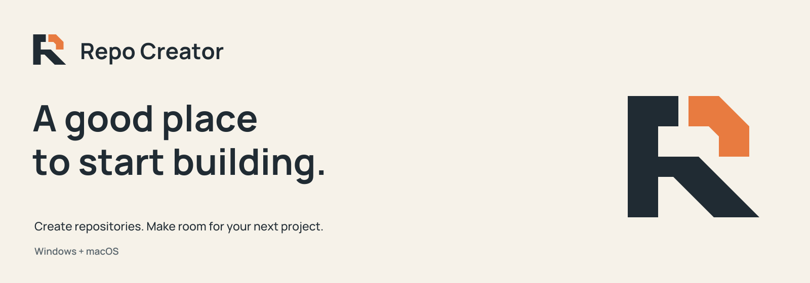
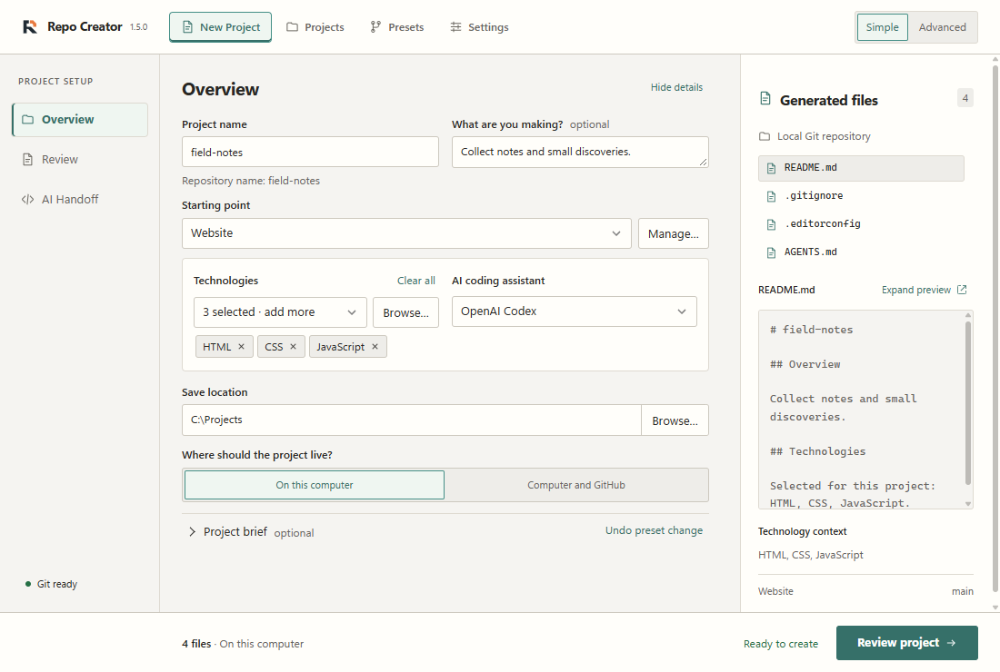
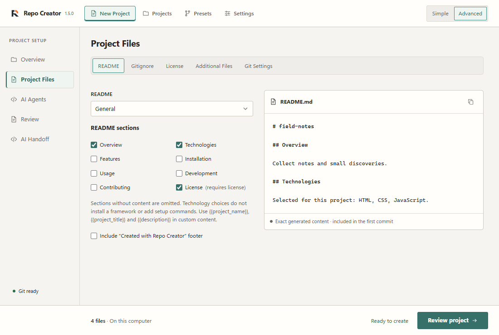
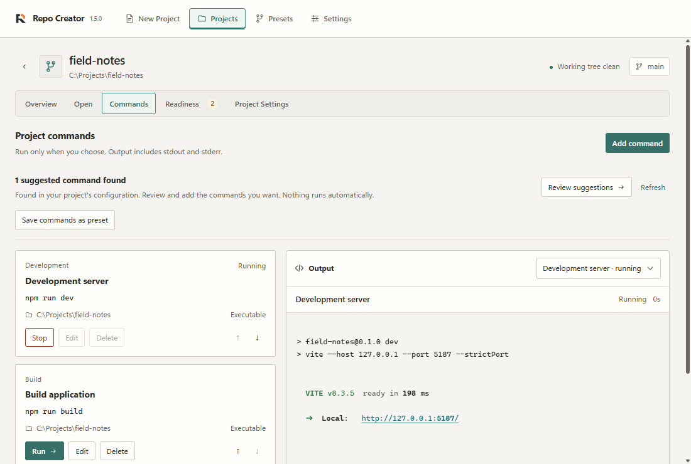
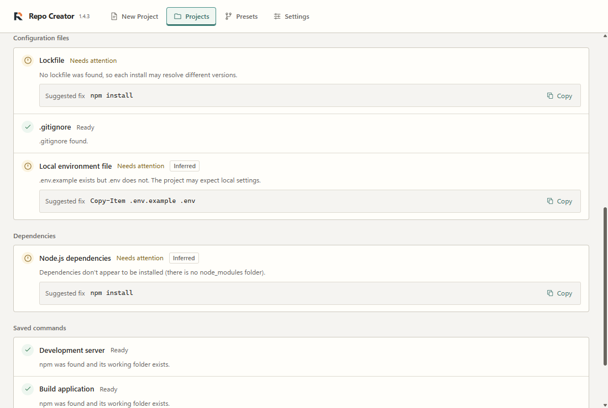

<picture>
  <source media="(prefers-color-scheme: dark)" srcset="docs/branding/builder/exports/readme-banner-dark.png">
  <source media="(prefers-color-scheme: light)" srcset="docs/branding/builder/exports/readme-banner-light.png">
  
</picture>

<p align="center">
  <a href="https://github.com/DefinitivedCode/RepoCreator/actions/workflows/windows.yml"></a>
  <a href="https://github.com/DefinitivedCode/RepoCreator/releases"></a>
  <a href="LICENSE"></a>
  <a href="#download"></a>
  <a href="docs/development.md"></a>
</p>

A desktop workspace for starting Git repositories and returning to the projects you already have. Choose a stack, review the files, and create locally. Publish to GitHub when you're ready.

<p align="center">
  <strong><a href="#download">Download</a></strong>
  &emsp;
  <strong><a href="#your-first-project">Get started</a></strong>
  &emsp;
  <strong><a href="docs/README.md">Documentation</a></strong>
</p>

<picture>
  <source media="(prefers-color-scheme: dark)" srcset="docs/assets/overview-dark.png">
  <source media="(prefers-color-scheme: light)" srcset="docs/assets/overview-light.png">
  
</picture>

**Development preview.** The refreshed Overview, Commands and Settings captures show refinements following the published **v1.5.0 Beta**. Keystone branding and Project Readiness are already included in that Beta. The application version remains unchanged during development; check the [release notes](https://github.com/DefinitivedCode/RepoCreator/releases) for what's included in a download.

## Download

[**Browse releases and download your build →**](https://github.com/DefinitivedCode/RepoCreator/releases)

Published downloads are currently **prereleases**. Choose the package for your computer, read its notes and compare its checksum with the included `SHA256SUMS.txt`.

| Your computer             | Package to choose                                |
| ------------------------- | ------------------------------------------------ |
| Windows 11 · x64          | **Setup EXE** for a per-user install, or **MSI** |
| macOS 11+ · Apple Silicon | **ARM64 DMG**, then drag the app to Applications |
| macOS 11+ · Intel         | **x64 DMG**, then drag the app to Applications   |

<details>
<summary>Which release asset? Installers, portable copies and source code</summary>

Full asset names start with `Repo-Creator-<version>-`. Match the ending:

- Windows setup: `windows-x64-unsigned-setup.exe`; MSI: `windows-x64-unsigned.msi`.
- Windows portable copy: `windows-x64-unsigned-portable.zip`. Extract the whole archive together.
- Apple Silicon: `macos-arm64-adhoc.dmg`; Intel: `macos-x64-adhoc.dmg`.
- Mac `.app.tar.gz` files are alternative application bundles. `.sig` files and `updater.json` support the updater; they aren't installers.
- GitHub's source-code archives are for development. Packaged apps need no Node.js, Rust or source checkout.

</details>

Windows packages are unsigned at the operating-system level. Mac builds are ad-hoc signed and **not notarized**. Both Mac architectures are built and checked in CI; physical Mac installation and launch testing remain outstanding. Read the [installation guide](docs/getting-started.md), [Mac guide](docs/macOS-testing.md) or [troubleshooting](docs/troubleshooting.md) for platform details.

**Updates on your terms.** Supported installed builds offer **Stable** and **Beta** in **Settings → Updates**. Beta includes prereleases; Stable waits for eligible stable releases. You choose when to download and restart. Windows in-app installation requires an NSIS/MSI installation; portable ZIP copies are replaced manually. Move Mac apps out of the DMG into a writable installed location before updating. [How updates work →](docs/updates.md)

## From idea to first commit

| Create & configure                                                                                                                                    | Continue & check                                                                                                                                                 |
| ----------------------------------------------------------------------------------------------------------------------------------------------------- | ---------------------------------------------------------------------------------------------------------------------------------------------------------------- |
| **Start a repository.** Create local Git projects or publish to GitHub. Simple and Advanced share settings, with a review before creation.            | **Keep a project workspace.** Add existing repositories, reopen editors and terminals, and save commands with live output and stop controls.                     |
| **Shape the files.** Choose technologies and stack presets, reuse project presets, and preview README, gitignore, license and optional project files. | **See what's missing.** Project Readiness inspects files without running programs and offers actionable findings. Full checks show a plan for explicit approval. |
| **Give AI useful context.** Configure coding-agent instructions, specialists and skills. Prepare handoff prompts locally, without a model request.    | **Make it yours.** Light, dark and system themes, configurable accent colours, and Stable/Beta updates for supported installations.                              |

Selecting a technology describes your intended stack; it doesn't install a framework. AI configuration supports **Codex, Claude Code, GitHub Copilot, Cursor, Gemini CLI and OpenCode**. The tools themselves are optional.

<details>
<summary>Look inside Advanced mode</summary>

Choose README sections, ignore rules, a license and Git settings while checking the exact generated content. Switching between Simple and Advanced preserves your configuration.

<picture>
  <source media="(prefers-color-scheme: dark)" srcset="docs/assets/configuration-dark.png">
  <source media="(prefers-color-scheme: light)" srcset="docs/assets/configuration-light.png">
  
</picture>

</details>

## Pick up where you left off

Your project library brings existing and newly created repositories into one place. Inspect Git status, open an editor or terminal, and keep the commands you use close to the project. Opening a workspace never runs those commands automatically.

<picture>
  <source media="(prefers-color-scheme: dark)" srcset="docs/assets/workspace-dark.png">
  <source media="(prefers-color-scheme: light)" srcset="docs/assets/workspace-light.png">
  
</picture>

The Commands refinements are a **development preview**: ANSI colours render as text styles, web addresses open only when chosen, and suggestions remain subject to review. [Console details and safety](docs/project-workspace.md#run-and-stop) · [Before/after review](docs/commands-ux-review.md).

<details>
<summary>Project Readiness: useful findings before you run</summary>

Automatic inspection reads a bounded set of project files and locates tools. It reports **Ready**, **Needs attention**, **Not checked** or **Could not check**, with suggested fixes where possible. It doesn't install packages or apply fixes.

**Run full check** lists the programs and network checks before you approve them. Saved project commands are optional, reviewed separately and never selected automatically; running checks can be cancelled.

<picture>
  <source media="(prefers-color-scheme: dark)" srcset="docs/assets/readiness-dark.png">
  <source media="(prefers-color-scheme: light)" srcset="docs/assets/readiness-light.png">
  
</picture>

This fixture intentionally has no lockfile, installed packages or local environment file. No project commands were run for these findings. [Readiness details and safeguards →](docs/project-workspace.md#check-readiness)

</details>

[Explore the project workspace →](docs/project-workspace.md)

## Your first project

1. Open **Settings** to check Git and your commit identity.
2. Choose **Simple**, enter a project name and select a starting point such as **Experiment**.
3. Pick a save location and **On this computer**.
4. Select **Review project**, inspect the files, then **Create Project**.

You get a new child folder and an initial Git commit. Existing destinations are protected. Git and a commit identity are required; GitHub CLI and sign-in are needed only for optional publishing. Windows also needs Microsoft Edge WebView2, which the installer can provide. [Full getting-started guide →](docs/getting-started.md)

## Build & contribute

Built with **Tauri 2, React, TypeScript and Rust**. Install the [development prerequisites](docs/development.md#prerequisites), including Node.js 22.18+ in the supported Node 22 line and stable Rust, then:

```sh
git clone https://github.com/DefinitivedCode/RepoCreator.git
cd RepoCreator
npm ci
npm run desktop:dev
```

See [development and checks](docs/development.md) and [CONTRIBUTING.md](CONTRIBUTING.md). Report bugs and feature ideas through [GitHub Issues](https://github.com/DefinitivedCode/RepoCreator/issues); use [SECURITY.md](SECURITY.md) for vulnerability reporting.

---

<p align="center">
  <sub>Repo Creator · Make room for your next project.</sub>
</p>

<p align="center">
  <a href="LICENSE">MIT License</a>
  &emsp;
  <a href="THIRD_PARTY_NOTICES.txt">Third-party notices</a>
  &emsp;
  <a href="docs/README.md">Documentation</a>
</p>
