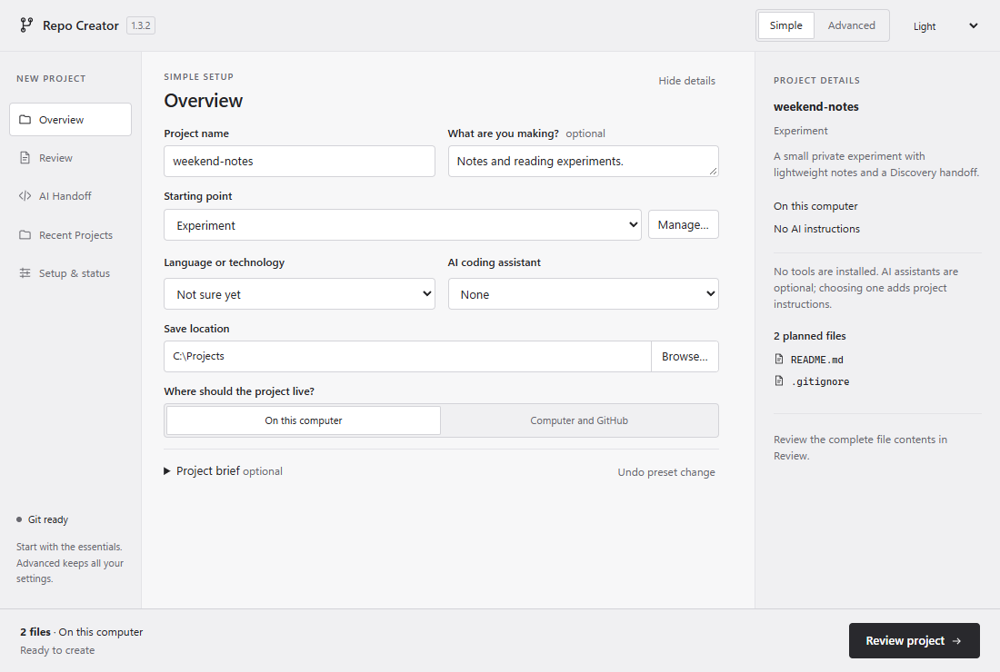
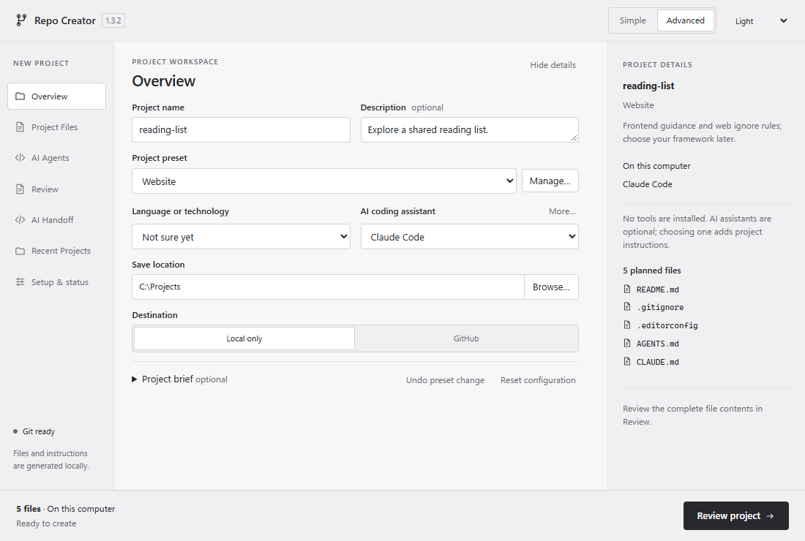

# Repo Creator

A desktop application for creating and configuring Git repositories on Windows and macOS.





## Features

- Create a local Git repository or publish it to GitHub.
- Use Simple Mode for everyday setup, or Advanced Mode for detailed configuration.
- Save and share reusable project presets.
- Generate a README, `.gitignore`, license and optional project files, with previews before creation.
- Add optional configuration for Codex, Claude Code, GitHub Copilot, Cursor, Gemini CLI and OpenCode.
- Prepare AI handoff prompts locally, without an AI account or API request.

## Download

The first public release has not been published. Approved installers will be available from [GitHub Releases](https://github.com/DefinitivedCode/RepoCreator/releases). While the repository is private, only the owner and invited collaborators can access its source and build artifacts.

| Your computer               | Choose                                                                |
| --------------------------- | --------------------------------------------------------------------- |
| Windows x64                 | The `windows-x64-unsigned-setup.exe` installer; MSI is also available |
| Mac with an Apple chip      | The `macos-arm64-adhoc.dmg` disk image                                |
| Mac with an Intel processor | The `macos-x64-adhoc.dmg` disk image                                  |

Windows builds are unsigned. Mac builds are ad-hoc signed and **not notarized**; macOS may block them. Read the [installation guide](docs/getting-started.md) and [Mac instructions](docs/macOS-testing.md) before opening a test build. Packaged applications do not require Node.js, Rust or a source checkout.

## Getting started

1. Install or open Repo Creator, then visit **Setup & status** to check Git.
2. Enter a project name and choose a starting point, such as **Experiment**.
3. Choose a save location and **On this computer** for a local project. Publishing through **Computer and GitHub** additionally requires GitHub CLI and sign-in.
4. Select **Review project**, inspect the files, then choose **Create Project**.

Repo Creator creates a new child folder and initial commit. Existing files and folders are never overwritten. See [Getting started](docs/getting-started.md) for the complete workflow and [Troubleshooting](docs/troubleshooting.md) for setup or publication failures.

## Requirements

- Windows 11 x64 with Microsoft Edge WebView2, or macOS 11 or newer with the matching Apple Silicon/Intel build. Mac packaging is checked in CI; physical Mac testing remains outstanding.
- [Git](https://git-scm.com/downloads) and a commit name/email. The app can set an identity only for the new repository.
- [GitHub CLI](https://cli.github.com/) and an authenticated account **only when publishing to GitHub**.
- Coding assistants and VS Code are optional. Generating assistant configuration does not install or run those tools.

## Development

Install the prerequisites in the [development guide](docs/development.md), then run:

```sh
git clone https://github.com/DefinitivedCode/RepoCreator.git
cd RepoCreator
npm ci
npm run desktop:dev
```

Cloning a private repository requires access. Downloading the application does not require cloning its source. Build, test and [release preparation](docs/releases.md) instructions are documented separately.

## License and support

Repo Creator is licensed under the [MIT License](LICENSE). Bundled dependencies retain their own licenses; see [third-party notices](THIRD_PARTY_NOTICES.txt).

Report ordinary bugs through [GitHub Issues](https://github.com/DefinitivedCode/RepoCreator/issues). Read [SECURITY.md](SECURITY.md) before reporting a vulnerability and [CONTRIBUTING.md](CONTRIBUTING.md) before submitting changes.
