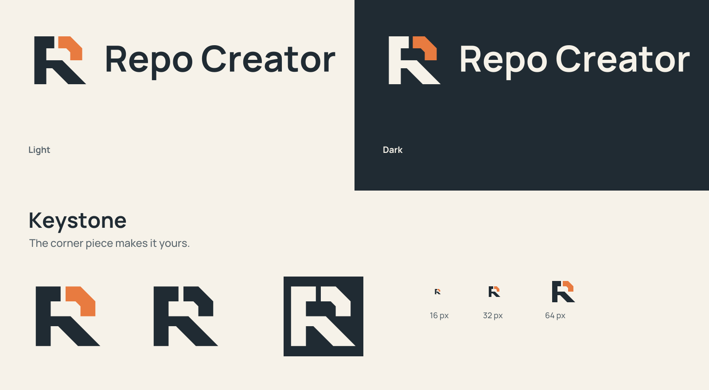

# Repo Creator / The Builder

**Proposed identity: Keystone.** Review artwork only. This directory does not
change the application, shipping icons, release configuration or root README.

Start with [the offline visual review](review.html), the
[brand presentation](brand-presentation.pdf) or the
[brand guidelines](brand-guidelines.pdf).



## Exploration and selection

The three original Builder explorations are **Keystone**, an assembled initial;
**Joinery**, a pair of interlocking beams; and **Benchmate**, a builder character.
The [comparison](review/concept-comparison.svg) includes each in colour, at small
sizes and in monochrome. Earlier Module/Join/Assembly studies in the parent
folder remain intact as historical explorations.

Keystone is the recommendation. The broken upper-right corner makes the R feel
assembled, while its chamfer echoes the diagonal leg. The silhouette connects
directly to the product name and stays readable with the accent removed.
Joinery has a useful craft metaphor but its inner joints become ambiguous at
16 px. Benchmate is personable but its hard hat is a familiar mascot device,
and its eyes become secondary at small sizes. This is a design judgement,
not a claim of trademark clearance or user testing.

## Asset map

| Location                         | Contents                                                | Use                                              |
| -------------------------------- | ------------------------------------------------------- | ------------------------------------------------ |
| `masters/logo-*.svg`             | Primary symbol + wordmark                               | Headers, documentation, product identity         |
| `masters/mark-*.svg`             | Standalone mark                                         | Compact brand placements                         |
| `masters/wordmark-*.svg`         | Outlined wordmark                                       | Typography-only placements                       |
| `masters/wordmark-live-text.svg` | Editable live text                                      | Editing with the supplied Manrope font installed |
| `masters/readme-banner-*.svg`    | 1600 x 560 hero                                         | Future README update after approval              |
| `masters/social-preview-*.svg`   | 1280 x 640 hero                                         | GitHub social image after approval               |
| `masters/app-icon-*.svg`         | 1024 x 1024 platform candidates                         | Source artwork for later icon integration        |
| `exports/`                       | Native PNGs and larger transparent logo exports         | Ready-to-place raster artwork                    |
| `icons/`                         | Windows PNGs, macOS PNGs, ICO, ICNS, favicon            | Replacement candidates only                      |
| `concepts/`                      | Three initial editable marks                            | Review and exploration                           |
| `review/`                        | Editable presentation and guideline pages, PNG previews | Design review                                    |
| `fonts/`                         | Manrope variable TTF, OFL and provenance                | Edit source lettering and documents              |
| `palette.json`                   | Fixed identity colours and type settings                | Brand reference, independent of UI accents       |
| `tools/`                         | Rebuild scripts                                         | Reproducible source and exports                  |

### Variants

`colour-light` uses Ink and Clay on light surfaces. `colour-dark` uses Paper and
Clay on dark surfaces. `mono-ink` and `mono-white` use one colour while retaining
the seam. All distributed lettering is outlined, with no font dependency.
The live-text file is the one deliberate exception.

PNG logo exports have transparent backgrounds. Banner and social-image PNGs
have intentional solid backgrounds. Native PNGs match the SVG dimensions.
`@4x` logo and wordmark PNGs have four times their native width. Standalone
mark high-resolution exports use `-1024.png` names.

The Windows icon uses a chamfered Paper tile so its dark body stays visible
against both light and dark desktops. The macOS candidate has an inset Paper
tile and transparent outer corners. The PNG sequences include native 16, 32
and 64 px renders. Dedicated 16 px optical masters align the stem, counter and
assembly seam to whole pixels for a sharper smallest-size result. ICO contains 16, 24, 32, 48, 64, 128 and 256 px PNG entries.
ICNS includes native 16 through 1024 px representations and retina entries.
No platform mask, badge or shadow needs to be applied to these precomposed
candidates. Revisit current platform requirements when integrating them.

## Approval and readiness

The logo family, outlined SVG masters, transparent PNGs and media exports are
complete production artwork for review. The guidelines describe the proposed
system, not an already adopted identity. The ICO and ICNS containers have been
structurally inspected and decoded. Physical Windows taskbar and macOS Dock
rendering still need maintainer review before adopting the candidates.

No design here is wired into Tauri, the UI, GitHub social settings or README.
Approval does not itself publish or integrate these files.

## Rebuild

Requires Python 3.12+, Inkscape 1.2+ and the Python packages in
[`tools/requirements.txt`](tools/requirements.txt). No npm or application
runtime dependency is added.

```sh
python3 -m pip install -r docs/branding/builder/tools/requirements.txt
python3 docs/branding/builder/tools/build.py
python3 docs/branding/builder/tools/build_docs.py
```

Run from any working directory. Fonts are local, and rebuilds make no network
requests. All geometry lives in `build.py`. PDF page layouts live in
`build_docs.py`; the generated SVGs also remain editable in vector software.
The bundled font uses OFL 1.1. Original artwork follows the repository's MIT
license. This addition does not change the repository license.
