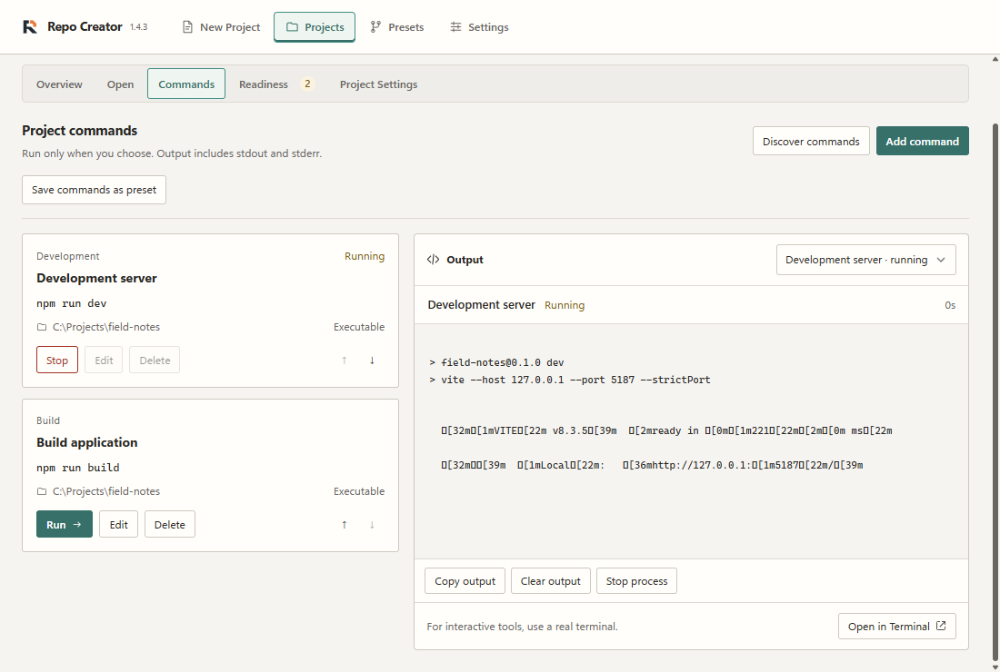
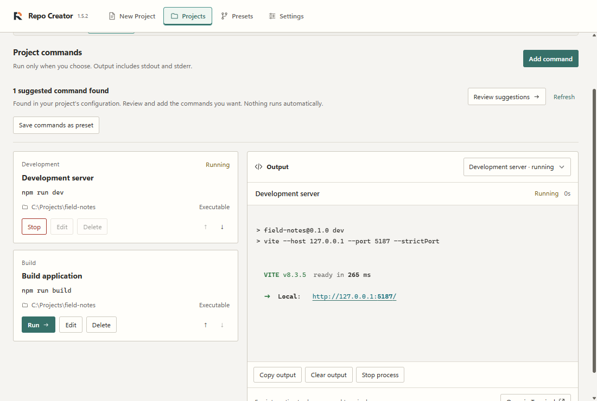
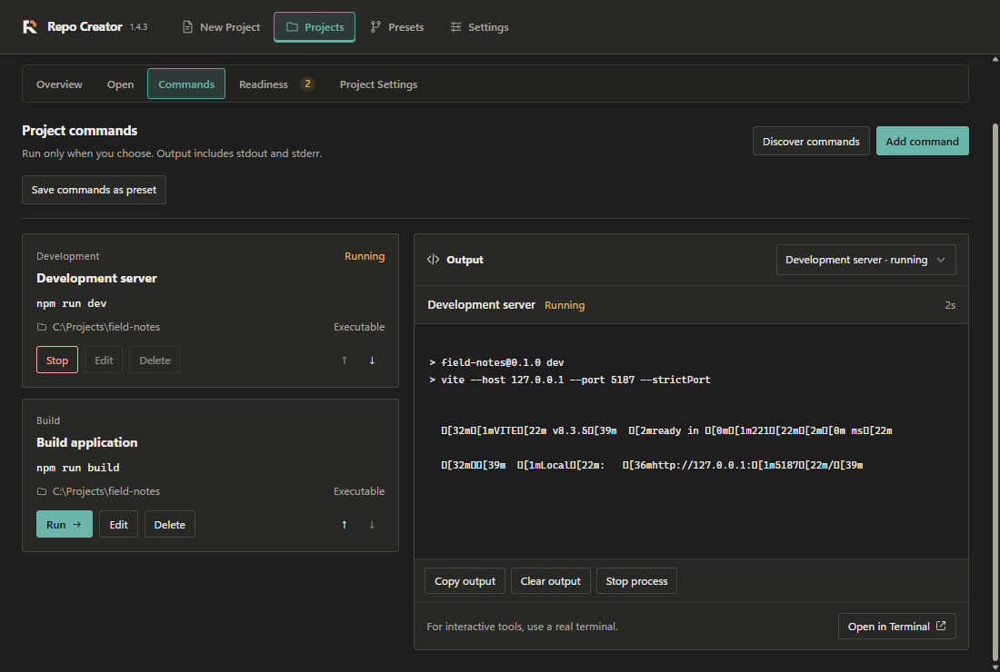
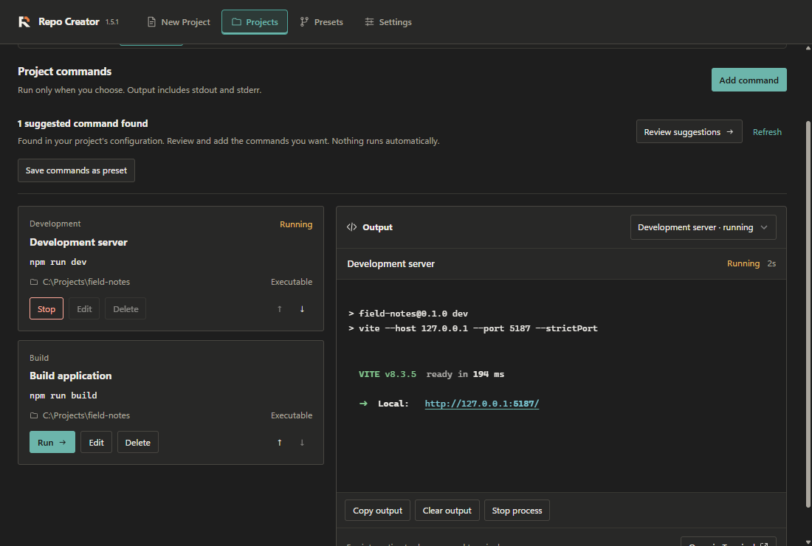
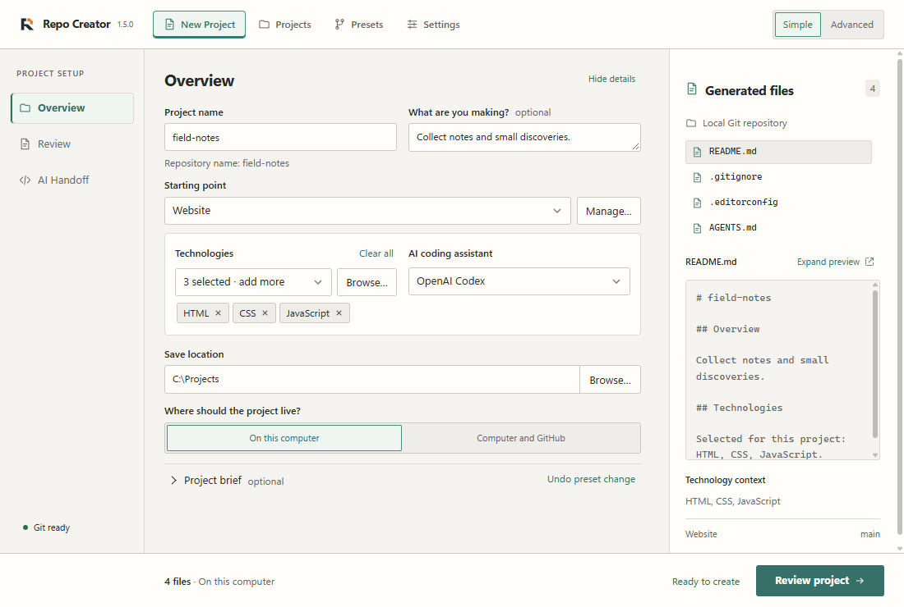
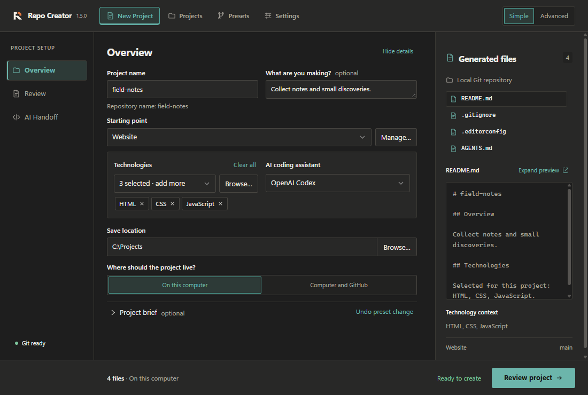
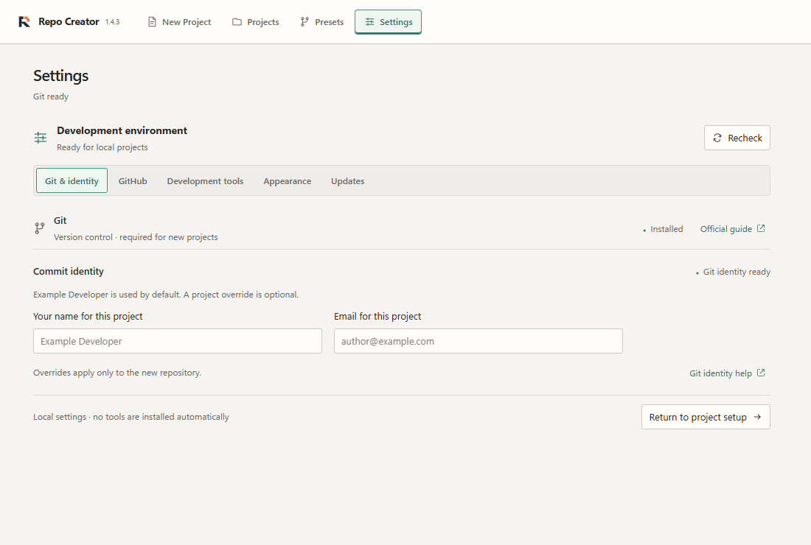
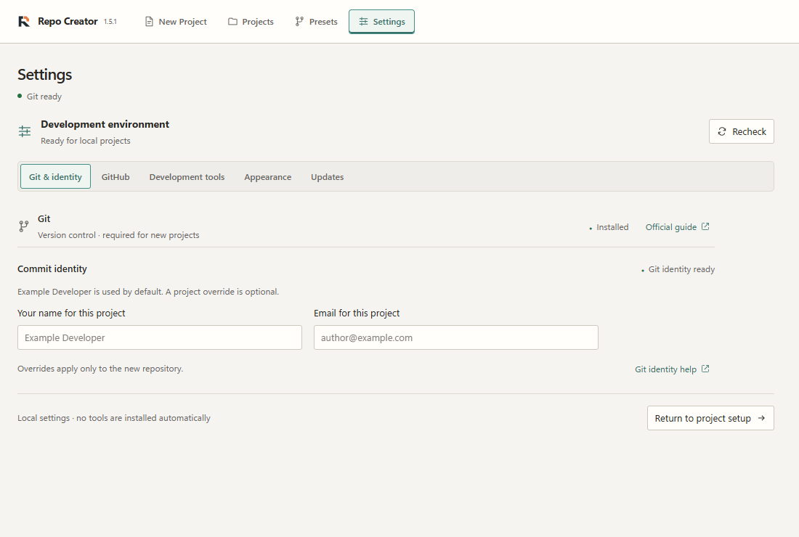
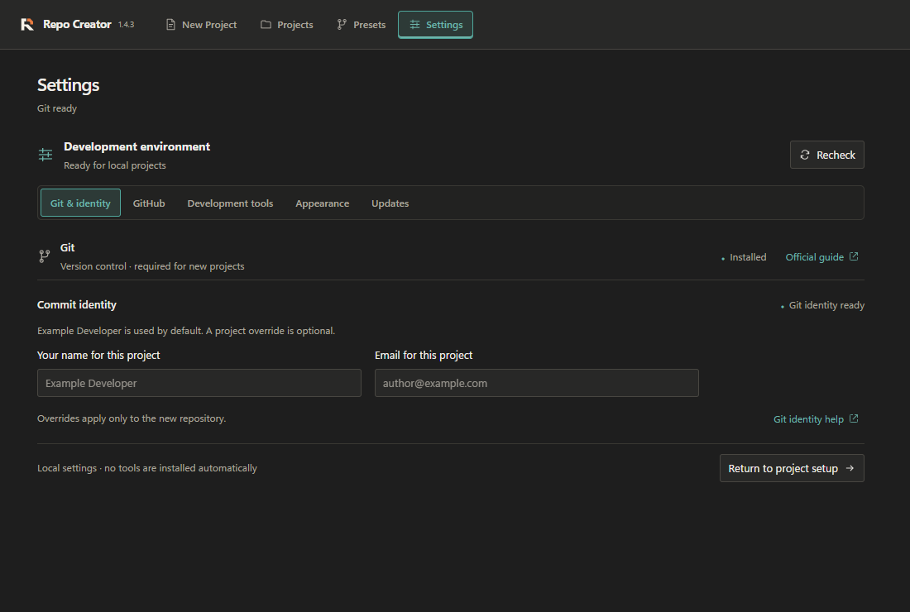
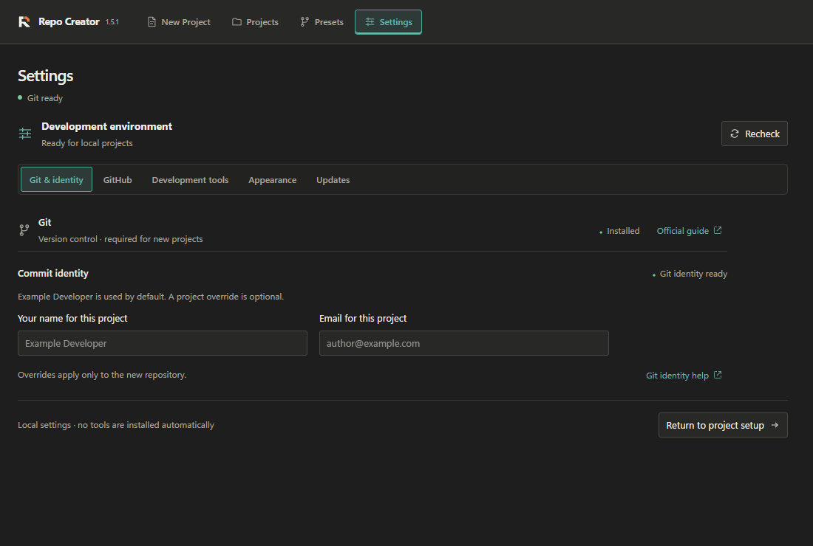

# Commands and UI refinement review

These changes are a development preview following v1.5.0 Beta. They preserve
Keystone branding, the command runner, imported-command confirmation, manual
creation, presets, cancellation, concurrency and retention limits. No versions,
release settings or website source were changed.

## Before and after

All images below are real Windows WebView2 captures at **1100 × 740**, using
the default Muted Teal accent, fictional Field Notes data and isolated settings.
Console and Settings before captures use the pre-change local build with a
1.4.3 header; its interface matches the v1.5.0 Beta UI (there are no `src/` or
native source changes between `8357223` and base `7a91d20`). Overview before
captures show the initial PR #14 implementation at `52c1b17`, with version 1.5.0
and Git readiness still above the footer. The corrected after captures place it
inside the same continuous bottom bar. All after captures retain version 1.5.0.
Images are unedited; Vite timing and elapsed time naturally vary.

| View                   | Before                                                                  | After                                               |
| ---------------------- | ----------------------------------------------------------------------- | --------------------------------------------------- |
| Console, light         |   |   |
| Console, dark          |     |     |
| Creation footer, light |  |  |
| Creation footer, dark  |    |    |
| Settings, light        |  |  |
| Settings, dark         |    |    |

The footer places Git readiness at the far left in a sidebar-width column,
followed by the file/destination summary, helper status and action. All four
share one bottom bar and vertical alignment. The former sidebar readiness button
is removed from the page structure, with no duplicate or CSS-hidden indicator.
Its keyboard-accessible Settings action and understated green dot are preserved.
Settings shares the library gutters and 1260-pixel content limit, with bounded
input fields and readable section widths.

## Verification

- TypeScript, formatting, 149 frontend unit tests and production frontend build.
- Rust formatting, locked Clippy with warnings denied, and 118 Windows Rust tests.
- Forty workspace browser checks and six new layout/status checks in both themes;
  forty-two existing creation, Settings and appearance checks, including enlarged text.
- Real Vite output from a temporary sample; ANSI resets, split escapes (including
  Clear during a partial escape), unsupported controls, HTML injection, safe URLs,
  keyboard activation, plain-text Copy, long lines and scroll following.
- Accurate suggestion counts, duplicate filtering, refresh/loading/error/empty
  states, malformed/oversized manifests, read-only inspection and first-run review.
- Windows desktop debug build and real WebView2 workspace smoke test covering
  native output, process lifecycle, concurrent runs, cancellation and persistence.
- Visual checks at 820 × 580, 1100 × 740 and 1500 × 900. Official images use
  the real application, not browser IPC mocks. macOS execution remains for CI.

The continuous-footer correction was additionally verified with 34 browser checks
across both themes: all four elements share a vertical centre, Git readiness
stays within the sidebar-width column, its Settings action works with the
keyboard, Tab reaches the review action, and the Review/Create workflow is
preserved. TypeScript, formatting, 149 unit tests and the Windows desktop build
pass. Overview and Project Files captures were refreshed from that real build.

The full browser run initially passed 104/106 checks. A startup timeout in
Appearance passed on retry. The separate existing `complex Studio subsections`
scroll-to-bottom assertion fails intermittently in this environment; it also
fails in both themes against an isolated copy of unchanged `main` at `7a91d20`.
It is outside these refinements and has not been changed or disabled.

## Separate website follow-up

`DefinitivedCode/repocreator-site` was inspected read-only. After the desktop PR
is merged, refresh these copied images from the matching official desktop assets:

| Website path                             | Desktop source                    | Reason                                            |
| ---------------------------------------- | --------------------------------- | ------------------------------------------------- |
| `public/screenshots/overview-light.png`  | `docs/assets/overview-light.png`  | Footer alignment and Git-ready success dot        |
| `public/screenshots/overview-dark.png`   | `docs/assets/overview-dark.png`   | Same changes in dark appearance                   |
| `public/screenshots/workspace-light.png` | `docs/assets/workspace-light.png` | Suggested commands and styled, linked Vite output |
| `public/screenshots/workspace-dark.png`  | `docs/assets/workspace-dark.png`  | Same changes in dark appearance                   |

The website's `index.html` screenshot captions, accessible link names and image
descriptions must distinguish these development refinements from published
v1.5.0 Beta and retire the 1.4.3-header caveat only for replaced images. Update
`docs/assets.md`, `asset-provenance.json`, its asset tests and README capture
notes together. Website preview images may then need recapturing because they
include these images. No website files, hosting, deployments or release state
were modified by this PR.
