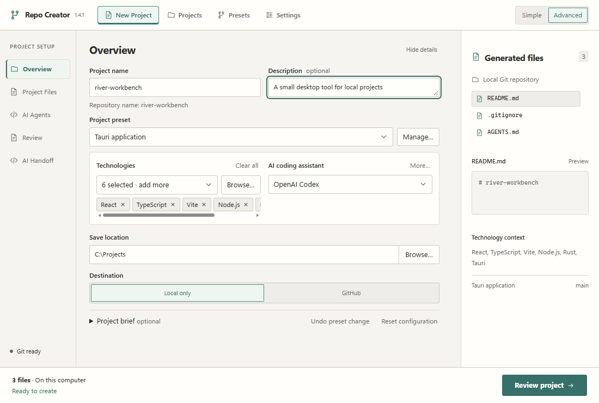
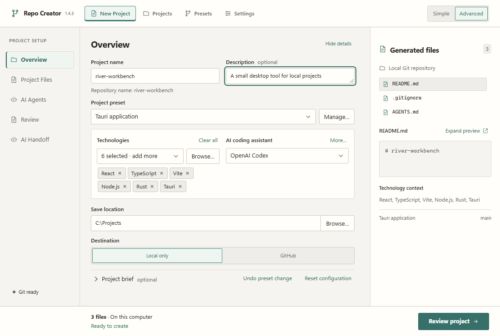
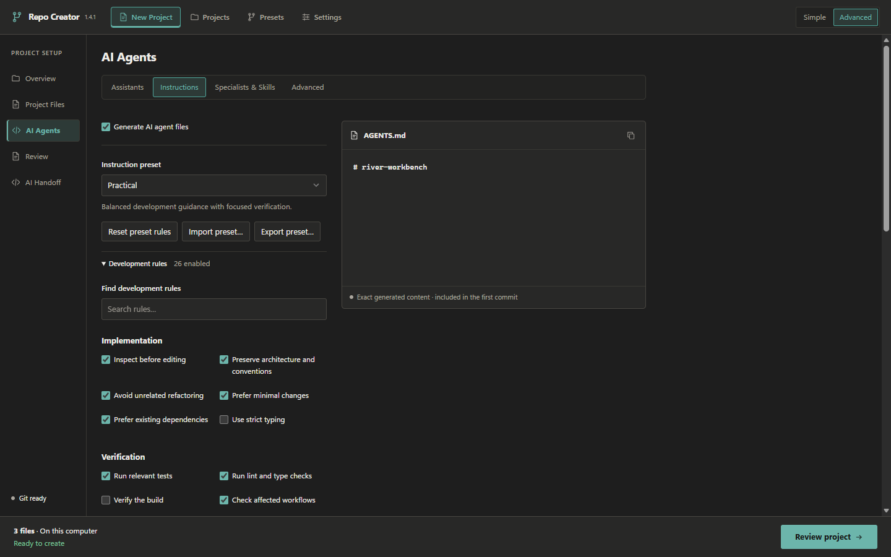
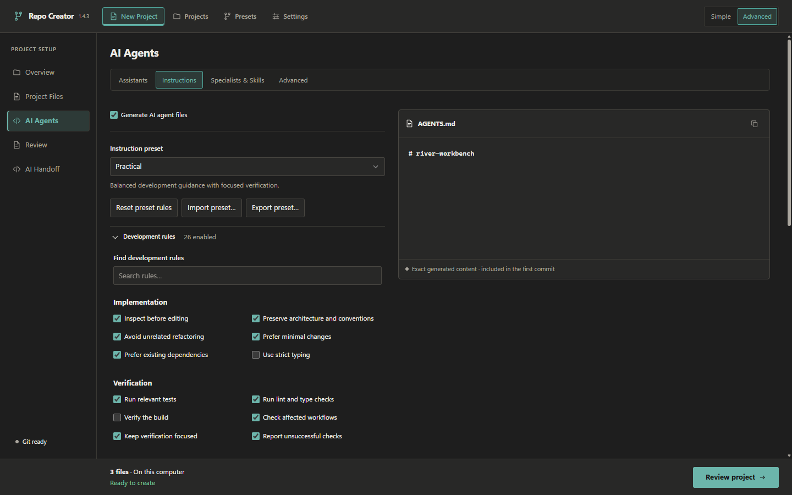
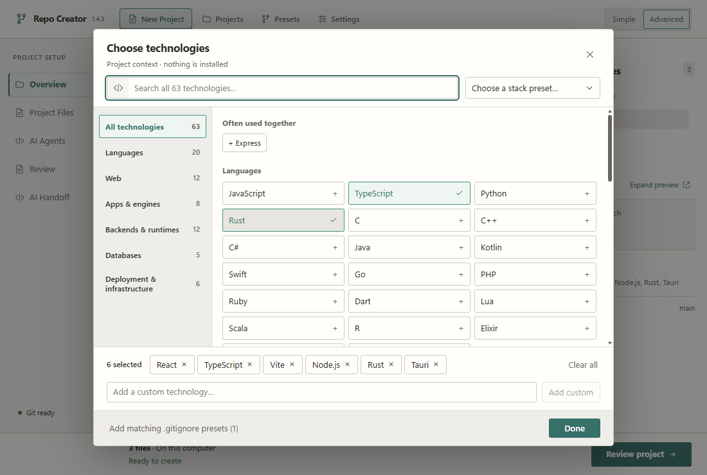
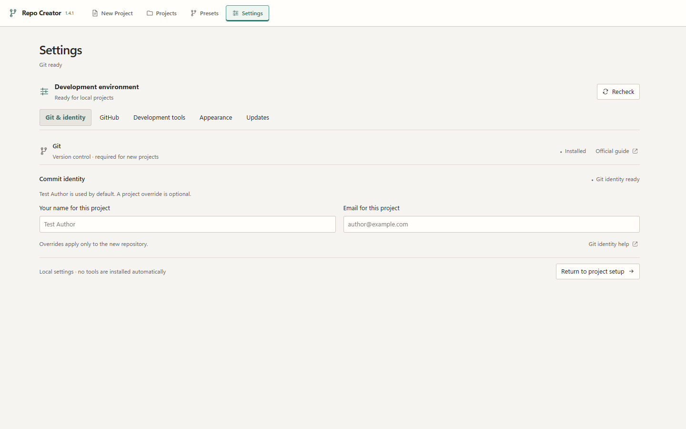
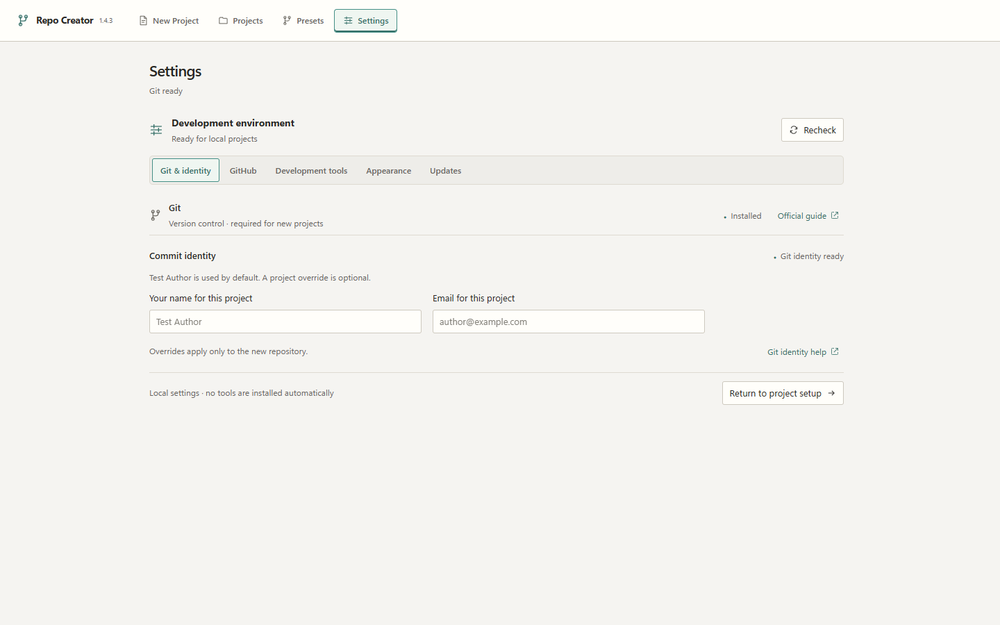
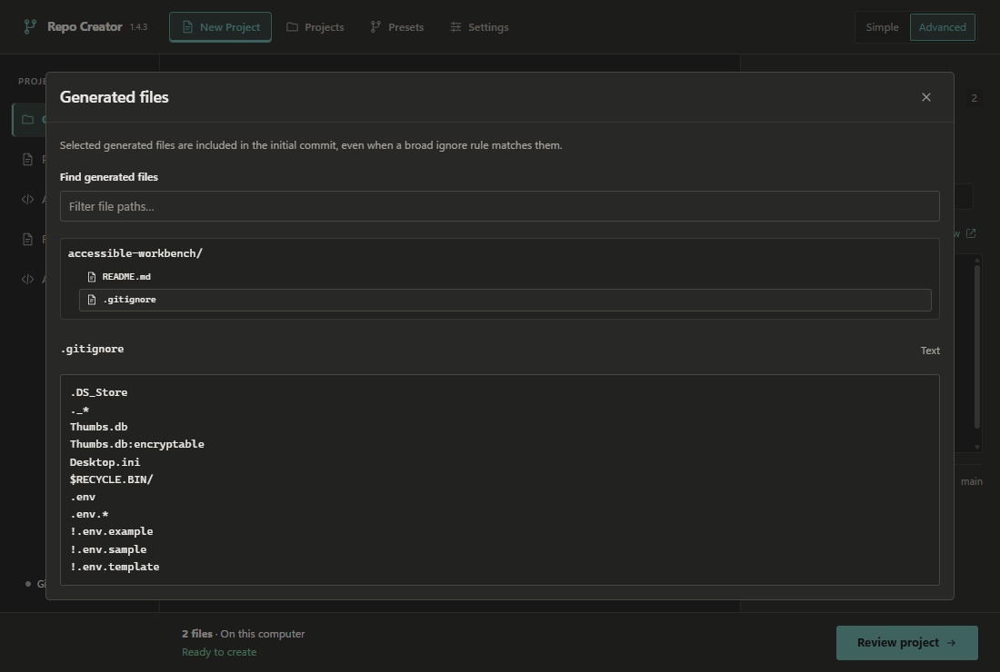
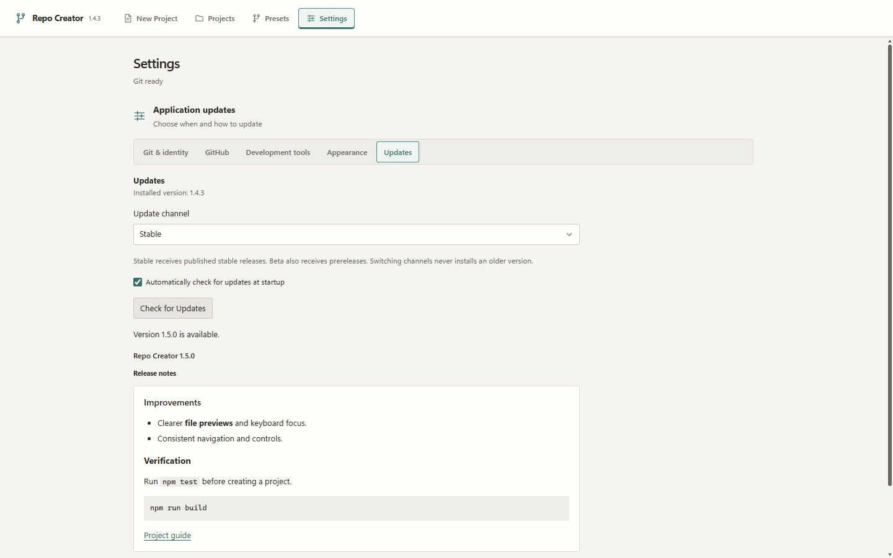

# v1.4.3 UI consistency audit

Baseline: `3c89648` (latest main at implementation start). Browser captures use Edge with
the existing Tauri IPC fixture; real generation is checked separately in the native smoke.
Screenshots are written to ignored `artifacts/ui-polish/{before,after}/{dark,light}`.

## Findings and corrections

- New Project: the 140px rail cramps navigation, while the fixed 254px Generated files
  column is too narrow. Files/Instructions stop at 880px even on wide windows. Increase
  rail/preview proportions, give editors more width, retain bounded form fields.
- Overview: selected technologies have a conspicuous horizontal scrollbar; the brief
  disclosure and connection actions look like labels. Wrap chips within a bounded area,
  give disclosures consistent chevrons, hover and keyboard focus treatment.
- Generated previews: Overview uses `white-space: pre` unlike other previews. Wrap long
  lines without changing content and provide an enlarged file dialog, including at the
  minimum width where the context column is hidden.
- AI Agents: headings, rule rows and sections have inconsistent spacing, and advanced
  configuration expands into one long column. Use shared spacing and a responsive grid
  of the existing advanced sections; preserve every field and disclosure.
- Settings: the library child rule overrides the intended form maximum width. Tabs use
  a different active treatment; Updates shows raw Markdown. Bound the settings form,
  unify equivalent tabs, and render safe Markdown inside a keyboard-scrollable region.
- Projects: retain the successful launcher and command layout; align workspace tabs,
  disclosure affordances, field sizing and command-dialog heading/scroll behavior.
- Presets/dialogs: retain cards and native modal focus handling; unify headings, action
  targets and restrained entry transitions. Keep long modal content scrollable.
- Shared: control heights/line heights and inline SVG treatment vary; native scrollbars
  dominate the selector. Share a small set of sizing/motion values and subtle scrollbars.
- Header: hardcoded 1.4.1 disagrees with the installed version. Use the existing native
  `get_update_info` result in both displays; test with an arbitrary future native version.
- Native smoke: exact Project name label matches include the repository-name helper.
  Give the input an explicit accessible name, a separate description, and use exact
  textbox role selectors in all affected native helpers.

## Verification record

Visual inspection covered the captured New Project sections, all Settings tabs, presets
and management, technology picker, project overview/launcher/commands/settings, command
editor and success screens. Both themes retain the original neutral surfaces and accent
roles. The same browser fixture, text, theme and viewport were used for each comparison.
Generated content in browser captures is the existing IPC test double; native smoke
separately verifies the real Rust output against previews, files and initial commits.

- Full Edge suite: **82 passed**, including existing configuration, scrolling, picker,
  file-editor, assistant, recovery and workspace coverage. Focused checks were repeated
  after final visual adjustments.
- Frontend: **116 unit tests passed**, TypeScript check and Vite production build passed.
- Rust on Windows x64: **98 tests passed**, locked Clippy with warnings denied, and rustfmt.
- Tooling: **25 helper tests passed**, version consistency (1.4.3), notice integrity and
  Prettier checks passed. No pre-existing dependency versions were upgraded.
- Windows Tauri **debug, no bundle** build passed. Both real WebView2 smoke workflows
  passed using isolated settings and temporary repositories. Reports derive their version
  from the manifest and assert it matches native IPC and the header.
- Layout: 820×580, 1024×680, 1100×740 and 1440×900; 125%/150% rendering emulation and
  enlarged-text checks. Native host display was 96 DPI (100%); OS scaling was not changed.
- Interactions: keyboard activation and disclosure content persistence, sampled opening
  **and closing** heights, chevron/focus states, reduced motion, exact expanded preview
  text, Escape/focus return, wheel/keyboard scrolling, dropdowns and three additional
  accents (Slate, Muted Gold, Copper). Existing appearance tests cover the remaining accents.
- Dialogs use a 160ms entry transition and native modal behavior; closing remains immediate
  to preserve reliable focus handling. Intrinsic disclosure transitions progressively
  enhance native details; older WebViews can open and close immediately.

The Markdown renderer is the only added direct dependency (`react-markdown`, pinned and
loaded on demand, approximately 36 kB gzip). Raw HTML stays escaped, remote images are
not fetched, unsafe links stay inert, and web links open through native URL validation.
Heading/list/inline-code/fenced-code rendering and long-note overflow have regressions.

macOS physical launch, installers, actual touchpad hardware, changed OS display scaling,
live GitHub publication and signed update installation were **not** tested here. Platform
CI and maintainer smoke remain required. No release, updater signing, feed, generation,
settings schema or publishing behavior is changed by this work.

## Screenshot comparisons

These tracked captures use fictional fixture data. The full capture matrix, native
reports and native screenshots stay under ignored `artifacts/` (native images may contain
temporary local paths).

| Screen                               | Before                                                              | After                                                             |
| ------------------------------------ | ------------------------------------------------------------------- | ----------------------------------------------------------------- |
| Overview · light · 1100×740          |             |             |
| Instructions · dark · 1440×900       |     |     |
| Technology picker · light · 1100×740 |  |  |
| Settings · light · 1440×900          |             |             |

The enlarged preview reuses the existing exact file browser. Update notes render Markdown
within a bounded region, keeping the existing check/download/install controls.

| Enlarged generated-file preview                            | Markdown release notes                               |
| ---------------------------------------------------------- | ---------------------------------------------------- |
|  |  |
